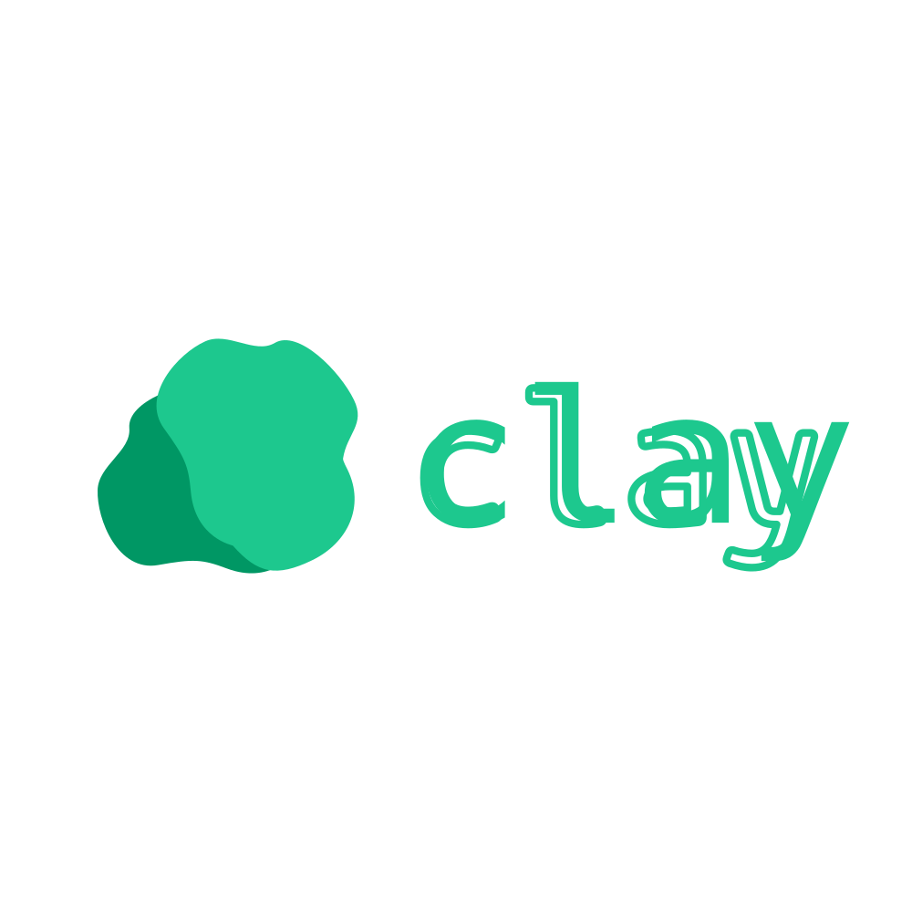

<p align="center">
  
</p>

<h1 align="center">Clay</h1>

<p align="center">
  <strong>Documentation sites from Markdown, built on <a href="https://nuxt.com/">Nuxt</a> and <a href="https://vuejs.org/">Vue</a>.</strong>
</p>

<p align="center">
  <a href="https://www.npmjs.com/package/clay-doc"></a>
  <a href="https://github.com/clay-doc/clay/blob/main/LICENSE"></a>
</p>

---

Write your docs as Markdown files in a `docs/` folder, add a `clay.yaml`, and Clay builds a fast,
searchable static site you can host anywhere, such as GitHub Pages.

- **Pre-rendered pages**: every page is real HTML, so it shows immediately and every search engine can read it.
  Moving between pages loads a small prebuilt payload; the browser never parses Markdown.
- **Full-text search** with <kbd>⌘ K</kbd> / <kbd>Ctrl K</kbd> or <kbd>/</kbd>: results link to the matching section,
  tolerate typos and match as you type; the words are highlighted on the page.
- **Navigation for every screen**: sidebar, a menu drawer on phones, "On this page", previous/next links.
- **Code blocks** highlighted with [Shiki](https://shiki.style/) for any language, with copy buttons.
- **SEO**: titles, descriptions, canonical URLs, Open Graph tags, breadcrumbs, `sitemap.xml` and `robots.txt`.
- **Light and dark theme**, following the system setting, with a toggle.
- **"Edit this page"** links and **last-updated dates** from git.
- **Checks** for broken links and typos in config files; `--strict` turns them into build failures.
- **Safe** for docs from outside contributors: rendered HTML is sanitized with [DOMPurify](https://github.com/cure53/DOMPurify).

## Quick Start

In the repository that holds your docs (Node.js 20.19 or newer):

```bash
npm install --save-dev clay-doc
```

Or try it without installing: `npx clay-doc dev`.

```text
.
├── docs/                  # Markdown files; folders become sections
│   ├── index.md           # Optional: the start page
│   ├── getting-started.md
│   └── guides/
│       ├── index.md       # Optional: the folder's page, name, icon and order
│       └── setup.md
├── clay.yaml              # Site settings
└── logo.svg               # Optional
```

A minimal `clay.yaml` only needs a title:

```yaml
title: "My Docs"
```

Then:

```bash
npx clay dev       # live preview at http://localhost:3000, reloads when docs change
npx clay build     # static site in publish/public
npx clay preview   # serve the build like a static host would
```

## Configuration

```yaml
title: "My Project"
favicon: "logo.svg"
baseURL: "/my-project/"             # path the site is served under (GitHub project pages)
siteURL: "https://my-org.github.io" # origin, for canonical URLs and the sitemap
lang: "en"
editURL: "https://github.com/my-org/my-project/edit/main/docs/"
fontawesomeKit: "abc123"            # optional; without it the free Font Awesome icons are used
version: "2.x"                      # label of docs/ in the version switcher (default: "Latest")
languages: ["en", "de"]             # optional; the first is the default language
navbar:
  logo: "logo.svg"
  source:
    name: "GitHub"
    icon: "fa-brands fa-github"
    link: "https://github.com/my-org/my-project"
  links:
    - name: "Homepage"
      icon: "fa-solid fa-house"
      link: "https://example.com"
```

Only `title` is required. `CLAY_TITLE`, `CLAY_BASE_URL`, `CLAY_SITE_URL` and `CLAY_FONTAWESOME_KIT` override
the matching settings at build time, e.g. in CI.

### Pages

Each Markdown file is a page. Optional front matter:

```yaml
---
title: Setup              # default: the first "# heading", then the file name
icon: fa-solid fa-wrench
description: How to set up the project, in one or two sentences.  # default: the first paragraph
order: 1                  # position in the navigation
---
```

Pages and folders are sorted alphabetically; entries with an `order` come first (`clay edit` sets these for you).

### Index pages

`index.md` in a folder is that folder's page, at the folder's URL (`docs/guides/index.md` → `/guides`), and its
front matter gives the folder its name, icon and order. `docs/index.md` is the start page. Two more fields lay out
these pages:

```yaml
---
title: Guides
icon: fa-solid fa-book-open
order: 2
cards: true   # cards of the folder's pages below the text
hero: true    # title, icon and description as a large centered header
---
```

An `index.md` with only front matter names the folder; a folder without text in its `index.md` (or without one)
shows its title and cards of its pages. In the sidebar, a folder's title opens its page; the arrow shows and hides
its entries.

Links between docs work like on GitHub: `[Setup](./guides/setup.md)` is resolved relative to the page. Sections
(`##` and deeper) show a `#` link next to their heading on hover.
Images and other files next to your docs (``) are published with the site.

### Versions

`docs/` is always the latest version, at the site root. Before a release changes the docs, save the current state
as an older version:

```bash
npx clay version 1.x   # copies docs/ to docs-archive/1.x/
```

Each folder in `docs-archive/` becomes a version under its own path (`/1.x/guides/setup`), with its own navigation and
search. A switcher in the navbar keeps the page when the other version has it, and older versions show a banner
that links to the latest one. Older versions stay editable; edit links point into `docs-archive/<name>/` when
`editURL` ends in `docs/`.

### Translations

List the languages in `clay.yaml` (`languages: ["en", "de"]`, the first is the default) and put each translation next
to its page: `setup.de.md` translates `setup.md`. The default language stays at the site root, others get their
prefix (`/de/setup`, `/1.x/de/setup`), and a switcher in the navbar keeps the page and version.

- A page without a translation is shown in the default language, with a note, and search engines are pointed to the
  original. Navigation, search and links work the same in every language.
- The position in the navigation comes from the original; the translation sets its own title, icon and description.
- Values in `clay.yaml` can be given per language: `title: {en: "Docs", de: "Doku"}`. Folders are translated with
  their `index.de.md`, like pages.
- The interface comes in English, German, French, Spanish, Italian, Portuguese, Dutch, Polish, Russian, Japanese,
  Chinese and Korean. `messages` in `clay.yaml` changes single texts, or adds a language:
  `messages: {de: {search: "Finden"}}`.

## Command Line

| Command        | Description                                       |
|----------------|---------------------------------------------------|
| `clay dev`     | Development server with live reload               |
| `clay build`   | Build the static site into `<out>/public`         |
| `clay preview` | Serve the build under its base URL, like GitHub Pages |
| `clay edit`    | Create, edit, order, rename, move and delete pages and folders, and edit `clay.yaml` |
| `clay version <name>` | Save the current docs as an older version in `docs-archive/<name>/` |

`clay edit` opens an editor in the terminal for every version (`v`; `V` saves a new one) and language (`l`): create pages (`n`) and
folders (`f`), edit their front matter (`⏎`), order them (`m`), rename (`r`), move (`o`) and delete (`x`) them, and
start translations (`c`); Tab switches to the settings in `clay.yaml`. Changes are written right away, only the
values that change: comments and formatting stay. Renaming, moving and deleting report the links that broke. With
`clay dev` running, the site updates with every change.

| Option         | Description                                                  | Default             |
|----------------|--------------------------------------------------------------|---------------------|
| `--root <dir>` | Docs project with `clay.yaml` and `docs/`                    | current directory   |
| `--out <dir>`  | Output directory                                             | `<root>/publish`    |
| `--port <n>`   | Port for `dev` and `preview`                                 | `3000`, `4173`      |
| `--strict`     | `build`: fail on broken links and unknown config keys        |                     |
| `--verbose`    | `build`: show the full Nuxt output instead of the progress   |                     |

## Deploying to GitHub Pages

```yaml
name: Deploy Docs
on:
  push:
    branches: [main]
  workflow_dispatch:

permissions:
  contents: read
  pages: write
  id-token: write

jobs:
  deploy:
    runs-on: ubuntu-latest
    environment:
      name: github-pages
      url: ${{ steps.deployment.outputs.page_url }}
    steps:
      - uses: actions/checkout@v7
        with:
          fetch-depth: 0  # full history for last-updated dates
      - uses: actions/setup-node@v7
        with:
          node-version: lts/*
          cache: npm
      - run: npm ci
      - run: npx clay build --strict
      - uses: actions/upload-pages-artifact@v5
        with:
          path: publish/public
      - id: deployment
        uses: actions/deploy-pages@v5
```

## Migrating from Clay 2

Clay 3 drops `dir-meta.yaml`, the `index` section of `clay.yaml` and the `versions/` folder; the build warns while
they are there.

1. Move each folder's `name`, `icon` and `order` from `dir-meta.yaml` into the front matter of the folder's
   `index.md` (`name` becomes `title`); names per language go into `index.de.md` and so on. Delete `dir-meta.yaml`.
2. Move older versions from `versions/<name>/docs/` to `docs-archive/<name>/`.
3. Write the start page in `docs/index.md`: `index.title`, `index.description` and `index.icon` become `title`,
   `description` and `icon`, with `hero: true` and `cards: true` for the previous layout. Remove `index` from
   `clay.yaml`.

## Migrating from Clay Oven

Clay 1 was a prebuilt frontend that the separate Clay Oven tool filled with your docs. Clay 2 builds the site
itself:

1. `npm install --save-dev clay-doc` in your docs repository (commit `package.json` and `package-lock.json`).
2. Replace the `run-oven.sh` step in CI with `npm ci` and `npx clay build`. The output is still `publish/public`.
3. Remove `langs` from `clay.yaml`: code languages are detected automatically.

`clay.yaml` and `docs/` stay as they are; then follow "Migrating from Clay 2".

## Developing Clay

```bash
npm install
npm run dev          # the sample site in playground/
npm test             # unit tests
npm run test:e2e     # browser tests (npx playwright install chromium first)
npm run typecheck
```

`modules/clay.ts` loads the docs at build time and pre-renders every page; `server/` renders Markdown;
`app/` is the Vue app. See [ROADMAP.md](ROADMAP.md) for planned work.

## License

This project is licensed under the Apache License 2.0 — see [LICENSE](LICENSE) for details.
