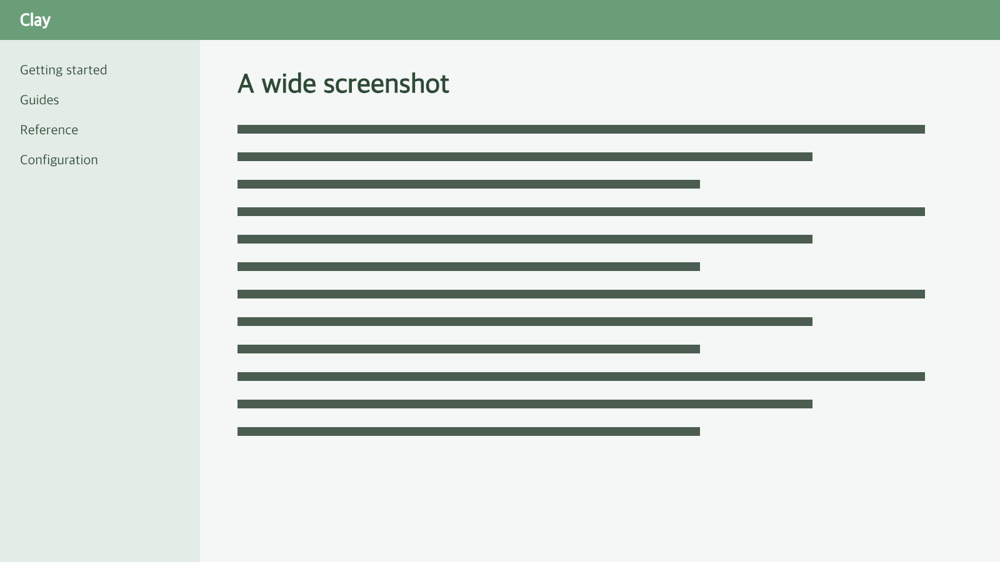

# Feature Tour

This page exercises links, images, code, alerts and tables.

## Links

Relative: [Configuration](../configuration.md), same folder: [Security](./security.md#forms), [external](https://example.com), [mail](mailto:team@example.com), and a [`code link`](../getting-started.md).

## Images and files




Download the [diagram](img/diagram.svg).

## Code

```ts
const answer: number = 42; // [!code highlight]
console.log(`answer: ${answer}`);
```

```go [main.go]
fmt.Println("hello")
```

```unknown-lang
plain text for an unknown language
```

Line notations:

```ts {1}
const config = loadConfig();
const site = buildSite(config); // [!code --]
const site = await buildSite(config); // [!code ++]
validate(site); // [!code warning]
publish(site); // [!code error]
```

```js
// [!code word:answer]
const answer = 42;
console.log(answer); // [!code focus]
```

## Alerts

> [!TIP]
> Alerts are rendered with icons.

## Tables

| Feature | Status |
|---------|--------|
| Search  | yes    |

## Task lists

- [x] Write the docs
- [ ] Publish them
