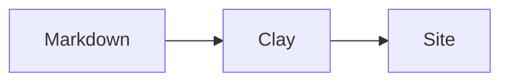
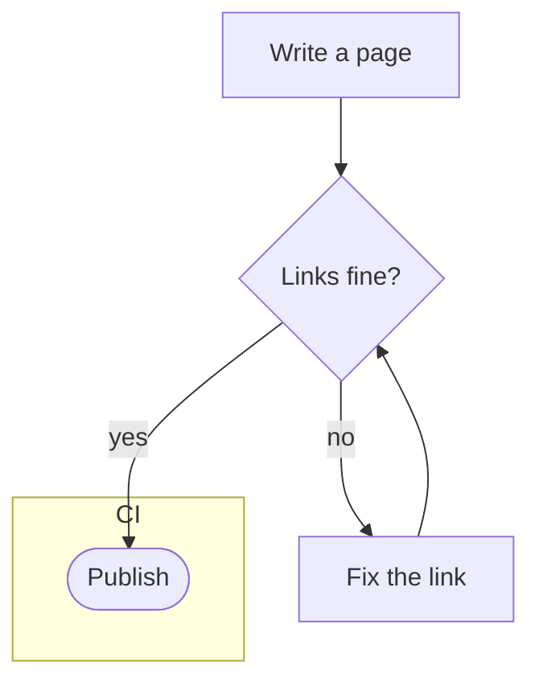
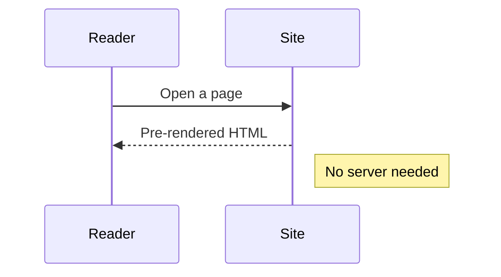
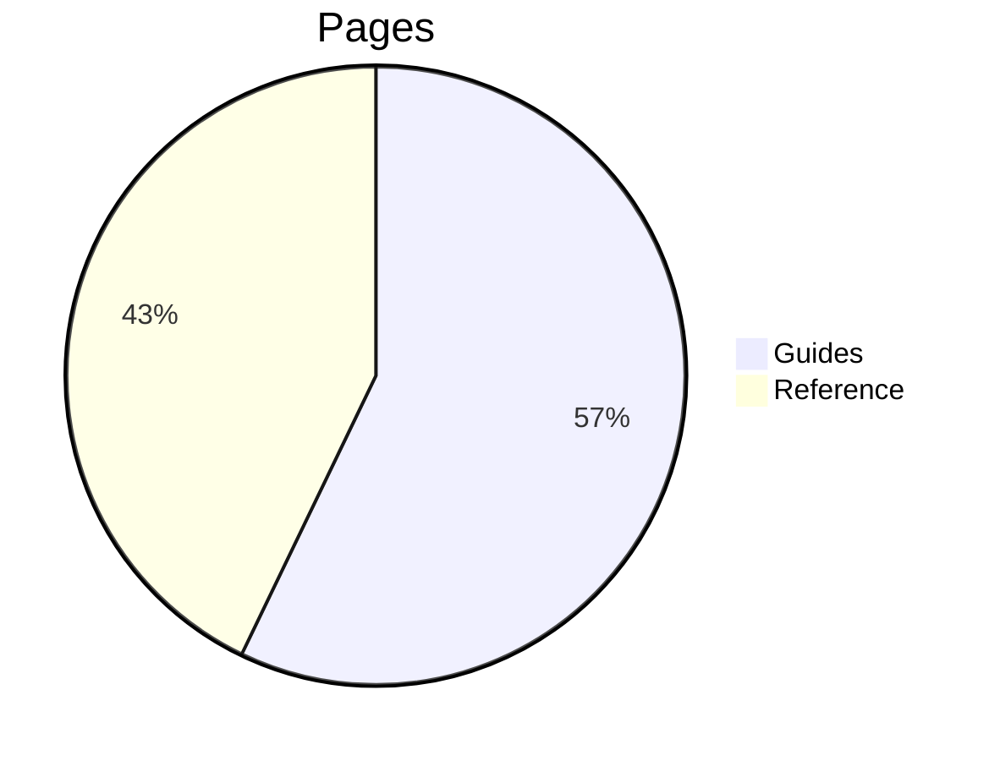

# Components :badge[New]

Every component Clay renders, on one page.

## Tabs

::: tabs
== macOS
Open the **Terminal** app.
== Windows
Open **PowerShell**.
:::

::: tabs
== Windows
Second group, Windows.
== macOS
Second group, macOS.
:::

## Code group

::: code-group
```sh [npm]
npm install clay-doc
```
```sh [pnpm]
pnpm add clay-doc
```
:::

## Steps

::: steps
1. Install Clay.
2. Write a page.
3. Build the site.
:::

## Cards

::: cards
- [Configuration](../configuration.md)
- [Security](security.md) {fa-solid fa-shield}
  Forms, scripts and styles in docs.
:::

## Details

::: details Why fold this?
Hidden folded text.
:::

::: details Show the configuration
A paragraph, then code:

```yaml
title: "My Project"
```
:::

## Prompt

::: prompt
Read the docs of this project and add a page about
**deploying** to `docs/guides/`.
:::

## Badges

Old option :badge[Deprecated]{warning}, new one :badge[Since 4.0]{tip}.

## Math

Inline: $E = mc^2$, prices like $5 and $10 stay text.

$$
\sum_{i=1}^{n} i = \frac{n(n+1)}{2}
$$

## Diagram









## File tree

```tree
my-project/
  docs/
    index.md   # the start page
    guides/
      install.md
      img/
        screen.png
    ...
  docs-archive/
  clay.yaml  # settings
  package.json
```

## Snippets

<!--@include: ../_snippets/note.md-->
